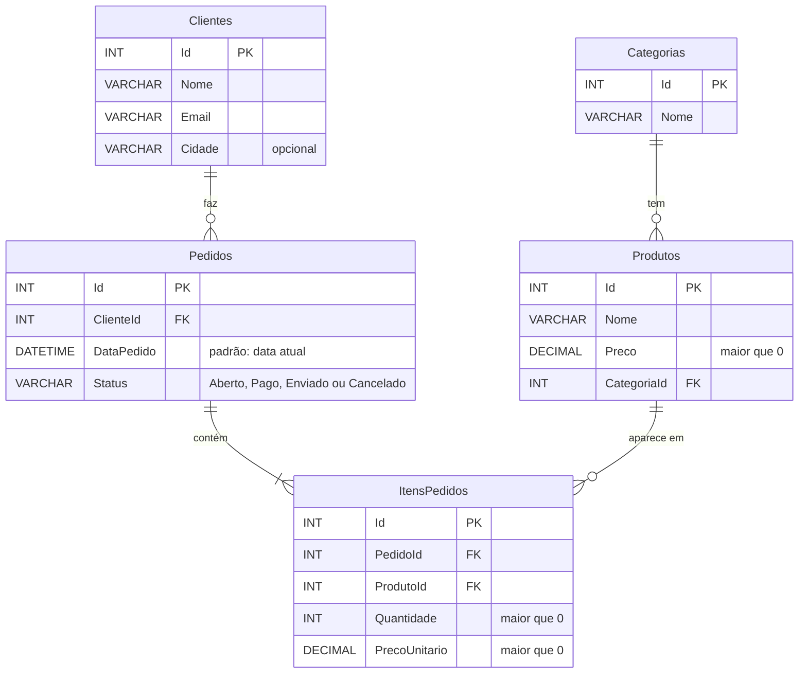

# 🏪 LojaDB: banco de dados de uma loja no SQL Server

Projeto de estudo de **SQL Server**, construído passo a passo enquanto aprendo SQL do zero.

O banco simula uma loja: **clientes**, **categorias**, **produtos**, **pedidos** e os **itens** de cada pedido.

## 🗂️ Modelo de dados

Um pedido pode ter vários produtos. Por isso os produtos de cada pedido ficam na tabela `ItensPedidos`, e não dentro de `Pedidos`. O `PrecoUnitario` guarda o preço do momento da compra, porque o preço do produto pode mudar depois.

## 📁 Arquivos

| Arquivo | O que faz |
|---|---|
| [`LojaBD.sql`](LojaBD.sql) | Apaga e recria o banco `LojaDB` com todas as tabelas. |
| [`Dados_loja.sql`](Dados_loja.sql) | Insere dados de exemplo em todas as tabelas. |
| [`Consultas.sql`](Consultas.sql) | Consultas com `JOIN`: pedidos com o nome do cliente, produtos com o nome da categoria e quais produtos cada cliente comprou (4 tabelas). |
| [`2.sql`](2.sql) | Resumos com funções de agregação: total de produtos, preço médio, mais caro e mais barato, e preço médio por categoria com `GROUP BY`. |

## ▶️ Como executar

1. Instale o **SQL Server** (a edição Developer é gratuita) e o **SSMS**.
2. Abra `LojaBD.sql` no SSMS e execute com **F5**.
3. Abra `Dados_loja.sql` e execute com **F5**.
4. Abra `Consultas.sql` e `2.sql` e execute as consultas.

> ⚠️ `LojaBD.sql` começa com `DROP DATABASE IF EXISTS LojaDB`, então rodá-lo de novo **apaga todos os dados** e recria o banco vazio.

## 🧠 O que já pratiquei

- `CREATE DATABASE` e `CREATE TABLE`
- Chave primária com numeração automática (`PRIMARY KEY`, `IDENTITY`)
- Chave estrangeira (`FOREIGN KEY ... REFERENCES`)
- Regras de integridade: `NOT NULL`, `CHECK` e `DEFAULT GETDATE()`
- `INSERT` com várias linhas, `DELETE ... WHERE`
- Consultas com `SELECT`, `WHERE` e `ORDER BY`
- `JOIN` entre duas tabelas, com `Tabela.Coluna` e títulos com `AS`
- `JOIN` combinado com `WHERE`
- Vários `JOIN`s em sequência, juntando 4 tabelas numa consulta só
- Funções de agregação: `COUNT`, `AVG`, `MAX` e `MIN`
- `GROUP BY` combinado com `JOIN` (resumo por categoria)

## 🚧 Próximos passos

- [x] `JOIN` entre duas tabelas
- [x] `JOIN` com várias tabelas (quais produtos cada cliente comprou)
- [x] Agregações com `GROUP BY` (resumo por categoria)
- [ ] Quanto cada cliente gastou (`SUM` + `GROUP BY` com várias tabelas)
- [ ] Email único para cada cliente
- [ ] Views, stored procedures e triggers
- [ ] Índices e análise de desempenho
